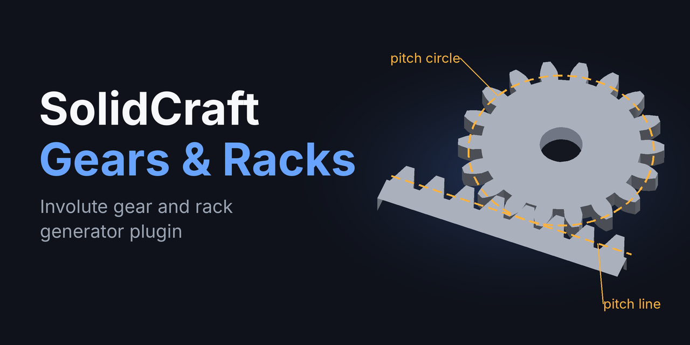

# SolidCraft Gears

Based on [solidcraft-gears](https://github.com/bherbruck/solidcraft-gears) by bherbruck (MIT). This version adds racks, one component per part, and separate Gears and Racks menu entries.

An involute spur gear and rack generator for [SolidCraft](https://github.com/tangency-labs/solidcraft). The plugin adds two items to SolidCraft's plugins menu, **Gears** and **Racks**. Each one opens a dialog, draws the profile in a sketch and extrudes it, using ordinary SolidCraft commands. What lands in your design is a normal timeline (a sketch, an extrude, and for gears a hub, a circular pattern and an optional bore), so you can open any of those features afterwards and change them. It is not a mesh.

Every run builds its part **in its own component**, so a gear and a rack (or two gears) stay independent and can be moved, constrained and exported separately.

The involute math is written from the textbook definitions. The plugin runs sandboxed as a WebAssembly component (`craft:plugin@0.1.0`, capability `commands@0.1`). It needs no files, no network and no clock.

## Install

You need a SolidCraft build that has the plugin host (the `commands@0.1` capability).

1. Download `solidcraft-gears-<version>.zip` from the [latest release](../../releases/latest).
2. In SolidCraft open **Preferences > Plugins > Install plugin...** and pick the zip. It shows the name, version and what the plugin asks for before it installs.
3. Run it from the plugins menu, under **Gears**: **Gears** or **Racks**. Each run needs your approval of the exact package contents.

You can also unzip it by hand into SolidCraft's plugins folder, so that a `solidcraft-gears` folder holding `plugin.json` and `plugin.wasm` ends up in it:

| OS | Plugins folder |
|---|---|
| Windows | `%LOCALAPPDATA%\SolidCraft\plugins\` |
| macOS | `~/Library/Application Support/SolidCraft/plugins/` |
| Linux | `$XDG_DATA_HOME/solidcraft/plugins/` (usually `~/.local/share/solidcraft/plugins/`) |

The release also has a `.sha256` file if you want to check the download.

## Use

All sizes are millimetres. The entry ids (`gears`, `racks`) are lowercase because the host only accepts lowercase ids; the menu labels come from each entry's slot name. Both entries start with a **Name** field: the component and the body are called that. It comes filled with `Gear` or `Rack`, and an empty name falls back to the same. Give each part its own name when you make several, so that component names stay distinct. After a run the root component is active again.

### gears

| Parameter | Default | Meaning |
|---|---|---|
| `name` | Gear | Component and body name (first field of the form) |
| `module` | 2 | Module m. Pitch diameter is m x z |
| `teeth` | 20 | Tooth count z, 8 to 80 |
| `face_width` | 10 | Gear thickness |
| `pressure_angle` | 20 | Pressure angle in degrees, 10 to 30 |
| `addendum` | 1 | Addendum coefficient ha: tooth height above the pitch circle, in modules, 0.3 to 2 |
| `dedendum` | 1.25 | Dedendum coefficient hf: tooth depth below the pitch circle, in modules, 0.3 to 2.5 |
| `bore_diameter` | 0 | Centre hole; 0 means none |
| `profile_shift` | 0 | Profile shift coefficient x, -1 to 1 |

The gear sits on the XY plane, centred on the origin, extruded up along +Z. The reply gives the pitch, base, outer and root diameters, and the addendum and dedendum used.

`addendum` and `dedendum` are multiples of the module, so they scale with it: with module 2 and the defaults the teeth stand 2 mm above and 2.5 mm below the pitch circle. Outer diameter is m (z + 2 ha + 2 x) and root diameter is m (z - 2 hf + 2 x), x being the profile shift. They do not change the tooth thickness on the pitch circle.

### racks

| Parameter | Default | Meaning |
|---|---|---|
| `name` | Rack | Component and body name |
| `module` | 2 | Module m. Circular pitch is pi x m |
| `teeth` | 10 | Tooth count, 1 to 100. Length is teeth x pi x m |
| `pressure_angle` | 20 | Pressure angle in degrees, 10 to 30 |
| `face_width` | 10 | Rack thickness |
| `addendum` | 1 | Addendum coefficient ha: tooth height above the pitch line, in modules, 0.3 to 2 |
| `dedendum` | 1.25 | Dedendum coefficient hf: tooth depth below the pitch line, in modules, 0.3 to 2.5 |
| `body_height` | 6 | Material below the root line |

The rack lies along +X on the XY plane, from x = 0 to its length, extruded up along +Z. Its pitch line is y = 0 and its teeth point towards +Y (tips at y = ha m, roots at y = -hf m, back at y = -hf m - body height). The reply gives the pitch, length and total height, and the addendum and dedendum used.

### Making them mesh

Use the same module and pressure angle for both, and keep some clearance: the addendum of one part should be smaller than the dedendum of the other, by 0.25 modules in the standard system (addendum 1, dedendum 1.25). If you change the addendum on one part, change the dedendum of the mating one to match. A gear from **Gears** meshes with a rack from **Racks** when the gear's centre is at (x, m z / 2), where z is the gear's tooth count. The rack then travels pi m z for each turn of the gear. Both parts are built on the XY plane, so move the gear's component to that centre (or constrain it there in an assembly) to line them up.

### From the command line

With a `solidcraft-cli` that has the plugin host:

```
solidcraft-cli run inspect.json --results        # [{"command":"plugin.inspect","params":{"path":"<plugins>/solidcraft-gears"}}]
solidcraft-cli run make.json --results --save gear.sc
```

where `make.json` is

```json
[{"command": "plugin.run", "params": {
  "path": "<plugins>/solidcraft-gears",
  "approval": "<the approval hash inspect gave you>",
  "entry": "gears",
  "params": {"name": "Pinion", "module": 2, "teeth": 20, "face_width": 10, "bore_diameter": 6}}}]
```

Use `"entry": "racks"` for a rack.

## What it builds

**gears**

- Full-depth teeth by default: addendum 1 m, dedendum 1.25 m (both adjustable with `addendum` and `dedendum`), so with no shift the outer diameter is m (z + 2 ha) and the root diameter m (z - 2 hf).
- Profile shift x moves the cutter: outer diameter m (z + 2 ha + 2x), root diameter m (z - 2 hf + 2x), and the tooth thickness on the pitch circle becomes m (pi/2 + 2 x tan a).
- Each flank is an involute of the base circle (radius m z cos a / 2), drawn as a spline through 10 points computed exactly from the involute equations. Below the base circle (small tooth counts) the flank continues radially.
- The root fillet is a circle of 0.3 m tangent to both the root circle and the flank. It is an approximation of the true trochoidal root a hob would cut, and it shrinks on its own if the gap is too narrow.
- The build extrudes one tooth wedge onto a hub and repeats it with a circular pattern, which gets slow as the count grows, so the tooth count is capped at 80 to stay inside the host's 30 second limit.

**racks**

- The straight-flanked limit of the involute: flanks inclined at the pressure angle, addendum 1 m and dedendum 1.25 m by default, circular pitch pi m. Addendum and dedendum are adjustable. Tooth thickness on the pitch line is pi m / 2, and the tooth is m (pi/2 - 2 ha tan a) wide at the tip.
- The whole outline is one closed polyline (4 edges per tooth), extruded once. There is no pattern, so long racks stay cheap; the cap of 100 teeth is only there because every edge is one host command.
- Each part's features carry its name (`<name> tooth profile`, `<name> tooth`, `<name> bore`), so two gears in one design do not get mixed up.

If a combination of addendum, dedendum, pressure angle and profile shift would make a tooth come to a point or make neighbouring teeth touch at the root, the plugin stops with a message that names the field to change.

Not modelled: undercut for very small tooth counts (hence the minimum of 8), backlash, helical or bevel teeth, tip relief, and for racks a root fillet and profile shift.

## Tests

`cargo test` checks the math (diameters, tooth thickness at the pitch circle and pitch line, flank angle, that the profiles close up), the commands each entry sends (one component per run, named after the part, back to the root at the end), parameter validation, and the manifest (entry ids, field order, description length).

`tests/cli_test.py` runs the built plugin through `solidcraft-cli`, saves each design, and measures the result: one closed solid in its own component, the tooth count from the number of tip faces, the outer diameter from the largest cylinder, the bore, the face width, the pitch diameter by cutting a thin ring around d = m z out of the gear, and for racks the length, the height and the volume.

```
./build.sh
SOLIDCRAFT_CLI=/path/to/solidcraft-cli python3 tests/cli_test.py
```

## Build

You need Rust with the `wasm32-unknown-unknown` target and [`wasm-tools`](https://github.com/bytecodealliance/wasm-tools). `./build.sh` builds the core module, wraps it as a component and leaves the package in `dist/solidcraft-gears/`. The WIT in `wit/` is a copy of SolidCraft's `craft:plugin@0.1.0`.

```
src/lib.rs     entries, parameters, the command sequences, the WebAssembly glue
src/gear.rs    involute gear geometry
src/rack.rs    rack geometry
plugin.json    manifest: the `gears` and `racks` entries and their input schemas
tests/         end to end test through solidcraft-cli
```

## Releases

Pushing a tag like `v0.5.0` runs `.github/workflows/release.yml`, which builds the plugin and attaches `solidcraft-gears-0.5.0.zip` and `solidcraft-gears-0.5.0.zip.sha256` to a GitHub release. The version in `Cargo.toml` and `plugin.json` has to match the tag.

## License

MIT, see [LICENSE](LICENSE).
